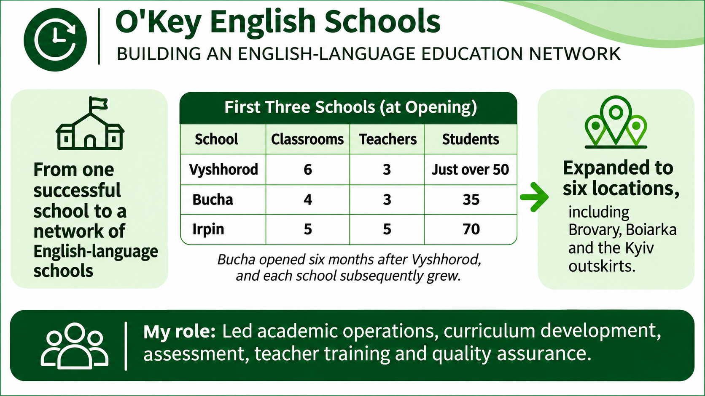
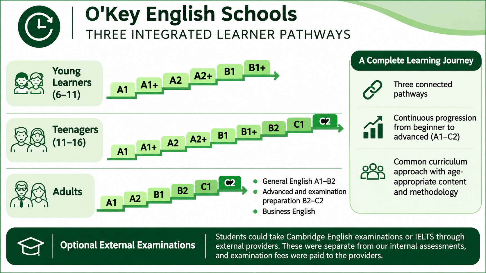
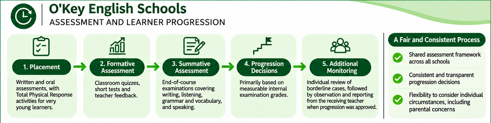
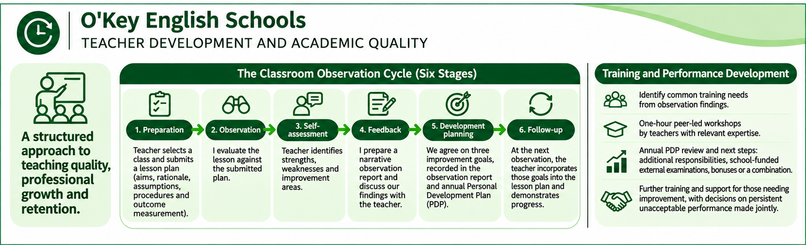

# O’Key English Schools

**Co-Founder & Academic Director | Kyiv Region, Ukraine | 2014–2022**

## Building an English-Language Education Network

Following the success of York English School (YES), my business partner and I established O’Key English Schools to make quality English-language education accessible to working families in towns around Kyiv.

We researched potential locations and developed a neighbourhood-based school model.

Our first three schools opened with the following resources and enrolments:

| School | Classrooms | Teachers | Students |
|---|---:|---:|---:|
| Vyshhorod | 6 | 3 | Just over 50 |
| Bucha | 4 | 3 | 35 |
| Irpin | 5 | 5 | 70 |

*All figures represent the schools at opening. Bucha opened six months after Vyshhorod, and each school subsequently grew.*

O’Key eventually expanded to **six locations**, including Brovary, Boiarka and the Kyiv outskirts.

I led academic operations, curriculum development, assessment, teacher training and quality assurance. My business partner managed marketing, finance and general business operations. We recruited teachers jointly.

## Three Integrated Learner Pathways

I designed an integrated curriculum enabling students to progress from beginner-level English through to advanced study.

| Pathway | Curriculum progression |
|---|---|
| **Young Learners (6–11)** | A1 → A1+ → A2 → A2+ → B1 → B1+ |
| **Teenagers (11–16)** | A1 → A1+ → A2 → A2+ → B1 → B1+ → B2 → C1 → C2 |
| **Adults** | General English A1–B2; advanced and examination preparation B2–C2; Business English |

The pathways provided continuity as students progressed between age groups.

I selected coursebooks and developed supplementary resources, including graded readers, videos, and grammar and writing materials.

Students could optionally take Cambridge English examinations or IELTS through external providers. These qualifications were separate from our internal assessments, and fees were paid to the providers.

## Assessment and Learner Progression

I established a consistent assessment framework across the schools:

1. **Placement:** Written and oral assessments, with Total Physical Response activities for very young learners.
2. **Formative assessment:** Classroom quizzes, short tests and teacher feedback.
3. **Summative assessment:** End-of-course examinations covering writing, listening, grammar and vocabulary, and speaking.
4. **Progression decisions:** Primarily based on measurable internal examination grades.
5. **Additional monitoring:** Individual review of borderline cases, followed by observation and reporting from the receiving teacher when progression was approved.

This framework supported consistent decisions while allowing individual circumstances, including parental concerns, to be considered.

## Teacher Development and Academic Quality

As the network expanded, I developed academic procedures to maintain consistent standards across locations.

Approximately two years after the first school opened, I introduced a formal teacher-development programme focused on teaching quality, professional growth and retention.

### Classroom Observation Cycle

Each teacher received **at least three observations per academic year**, increasing to four or five where additional support was needed.

The cycle comprised six stages:

1. **Preparation:** The teacher selected a class and submitted a lesson plan covering aims, rationale, assumptions, procedures and outcome measurement.
2. **Observation:** I evaluated the lesson against the submitted plan.
3. **Self-assessment:** The teacher identified strengths, weaknesses and improvement areas.
4. **Feedback:** I prepared a narrative observation report and discussed our findings with the teacher.
5. **Development planning:** We agreed on three improvement goals, recorded in the observation report and annual Personal Development Plan (PDP).
6. **Follow-up:** At the next observation, the teacher incorporated those goals into the lesson plan and demonstrated progress.

### Training and Performance Development

I analysed observation findings across the teaching team to identify common training needs. These informed staff-development sessions, including **one-hour peer-led workshops** delivered by teachers with relevant expertise.

At the end of each academic year, I reviewed each teacher’s PDP and determined appropriate next steps.

Strong performance could lead to additional responsibilities, school-funded external examinations selected by the teacher, bonuses or a combination of these.

Teachers needing improvement received further training and support. Decisions concerning persistent unacceptable performance, including dismissal, were made jointly with my business partner.

## Professional Skills Demonstrated

- **Learning design:** Integrated curricula, learner pathways and instructional resources.
- **Assessment design:** Placement, formative and summative assessment, and progression procedures.
- **Training needs analysis:** Identifying development priorities through classroom observations.
- **Performance development:** Structured feedback, improvement goals and annual PDP reviews.
- **Quality assurance:** Consistent academic procedures across a growing school network.
- **Leadership and collaboration:** Academic direction, teacher development and shared recruitment responsibilities.
