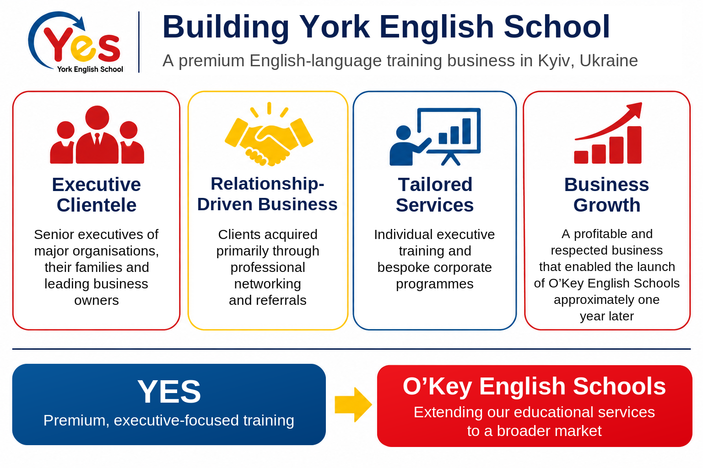
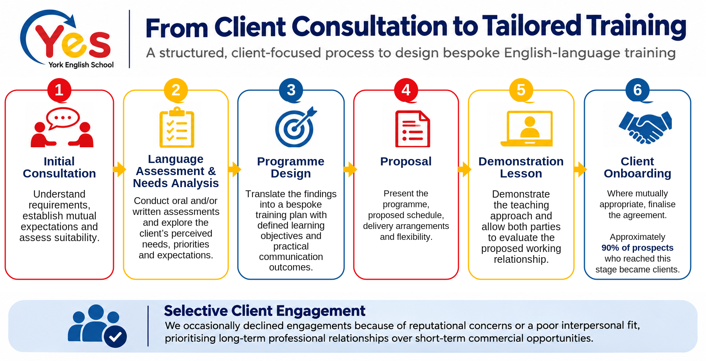
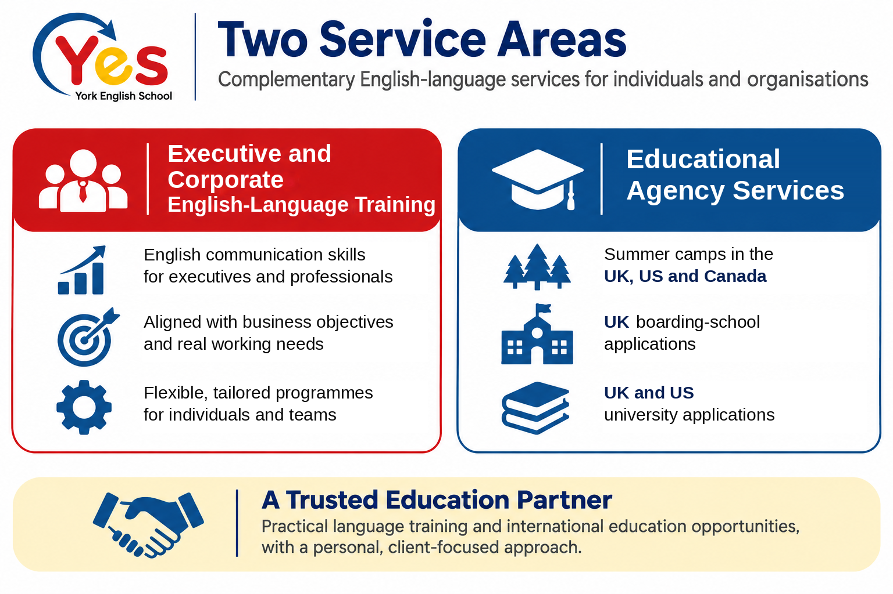

# York English School (YES)

**Co-Founder & Academic Director | Kyiv, Ukraine**

## Building a Premium English-Language Training Business

After relocating from Donetsk to Kyiv, my business partner and I established York English School (YES), providing bespoke English-language training to senior executives of major Ukrainian organisations, their family members, and leading business owners.

YES operated as a premium, relationship-driven business, with clients acquired primarily through professional networking and referrals. Our services included individual executive training and tailored corporate programmes.

I directed academic operations, client needs assessment and programme design. My business partner managed marketing, finance and general business operations. We jointly recruited teachers.

YES's reputation and profitability enabled us to establish O'Key English Schools approximately one year later, extending our educational services to a broader market.

## From Client Consultation to Tailored Training

I developed and delivered a structured consultation and needs analysis process to design English-language training programmes aligned with clients' business objectives, professional goals and long-term vision.

The process comprised six stages:

1. **Initial consultation:** Understand the prospective client's requirements, establish mutual expectations and assess suitability.
2. **Language assessment and needs analysis:** Conduct oral and/or written assessments and explore the client's perceived needs, priorities and expectations.
3. **Programme design:** Translate the findings into a bespoke training plan with defined learning objectives and practical communication outcomes.
4. **Proposal:** Present the programme, proposed schedule, delivery arrangements and flexibility.
5. **Demonstration lesson:** Demonstrate the teaching approach and allow both parties to evaluate the proposed working relationship.
6. **Client onboarding:** Where mutually appropriate, finalise the agreement. Approximately 90% of prospects who reached this stage became clients.

Client selection was deliberately selective. We occasionally declined engagements because of reputational concerns or a poor interpersonal fit, prioritising long-term professional relationships over short-term commercial opportunities.

## Two Service Areas

YES developed two complementary service areas.

### Executive and Corporate English-Language Training

We delivered bespoke programmes designed around the communication demands of senior leadership, professional responsibilities and long-term development priorities.

Our approach combined objective language assessment with clients' own perceptions of their needs, ensuring that learning plans were both relevant and practical.

### Educational Agency Services

We expanded into international educational services, supporting clients and their families with:

- Summer camps in the United Kingdom, United States and Canada.
- Applications to UK boarding schools.
- University applications in the United Kingdom and United States.

This expansion built on established client relationships and extended our services beyond language training.

## Professional Skills Demonstrated

- **B2B training needs analysis:** Stakeholder consultation, diagnostic assessment and requirements identification.
- **Learning programme design:** Bespoke training plans aligned with business and professional objectives.
- **Executive stakeholder engagement:** Direct relationships with senior decision-makers and leading business owners.
- **Solution development and presentation:** Translating client requirements into structured proposals and demonstrating the proposed approach.
- **Educational leadership:** Academic direction, programme oversight and teacher recruitment.
- **Business development:** Relationship-led client acquisition, selective engagement and service expansion.
